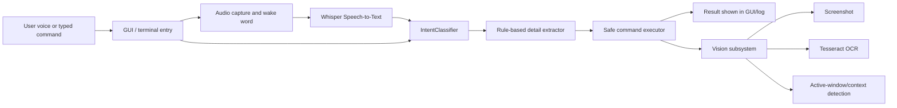

# Sound OS — Final Defense Report

## Evidence policy

This report is based on the repository files, generated artifacts, tests, and
Git history available in this checkout. Numerical results are reported only
when they are present in the repository or were reproduced from it. A result
that cannot be verified is marked **Not verified** rather than estimated.

## 1. Project introduction and problem definition

### Project concept

Sound OS is a Linux voice-controlled assistant. The user speaks a command, the
system converts speech to text, classifies the command into an intent,
extracts command details, and performs a safe Linux action.

The project addresses the practical problem of controlling a computer through
short natural-language commands instead of manually typing shell commands or
navigating multiple menus. The target is a controlled, explainable assistant
for common desktop operations, not a general-purpose conversational agent.

### Objectives

- Build a dataset written by the project team.
- Train and save an intent-classification model.
- Connect speech recognition to the trained classifier.
- Extract entities such as application names, file names, and folder paths.
- Execute safe Linux operations.
- Add screenshot, OCR, and screen-context capabilities.
- Provide a desktop GUI so the complete pipeline can be demonstrated without
  relying on terminal interaction.

### Scope

The implemented scope is command-oriented. The assistant supports application
control, file/folder operations, system information, date/time, screenshots,
OCR, and screen-context reporting. It does not contain a general LLM,
full image captioning model, unrestricted shell execution, or a guaranteed
description of arbitrary objects in a room.

## 2. System architecture and workflow



### Runtime sequence

1. `main.py` opens the GUI by default.
2. The GUI starts hands-free wake-word mode.
3. `WakeWordListener` listens for “hey sound”.
4. The following utterance is recorded until silence or timeout.
5. `faster-whisper` converts the audio to English text.
6. `IntentClassifier.predict()` selects an intent and confidence.
7. `nlp.extractor.extract()` finds application, name, location, or path.
8. `commands.executor.execute()` performs the allowed action.
9. The GUI displays the heard command, intent, confidence, and result.
10. Wake-word mode returns to waiting for the next command.

### Main files

| Area | Files | Responsibility |
|---|---|---|
| Entry point | `main.py` | GUI, text, terminal voice, and wake-word modes |
| GUI | `gui/app.py` | Tkinter desktop interface and background workers |
| Configuration | `config.py` | paths, intents, threshold, classifier-intent separation |
| Cleaning | `preprocessing/clean.py` | canonical lowercasing and punctuation cleaning |
| Dataset build | `preprocessing/build_dataset.py` | merge, validate, deduplicate, split |
| Training | `training/train.py` | TF-IDF + Logistic Regression training |
| Comparison | `training/compare_models.py` | five-fold macro-F1 comparison |
| Evaluation | `training/evaluate.py` | live prediction-path test evaluation |
| Intent model | `nlp/classifier.py` | model loading, confidence fallback, explicit routing |
| Extraction | `nlp/extractor.py` | application, name, location, and custom-path extraction |
| Audio | `speech/audio_capture.py` | microphone capture, calibration, silence detection |
| Speech | `speech/transcriber.py` | cached faster-whisper transcription |
| Wake word | `speech/wake_word.py` | “hey sound” detection and command capture |
| Linux actions | `commands/executor.py` | validated application, file, folder, and system actions |
| Vision | `vision/screen.py` | capture, OCR, active-window and activity context |
| Tests | `tests/` | unit, integration, safety, and pipeline regression tests |

## 3. Dataset and data understanding

### Repository data files

The raw dataset currently contains:

| File | Rows | Role |
|---|---:|---|
| `data/raw/raw_intents_data.csv` | 837 | Original/core command examples |
| `data/raw/vision_and_paths.csv` | 56 | Vision and custom-path examples |
| **Total raw rows** | **893** | Before merging and deduplication |

`data/raw/_template.csv` is a template and is intentionally ignored by the
dataset builder.

### Raw label distribution

The core file contains nine original labels:

| Intent | Rows |
|---|---:|
| `OPEN_APPLICATION` | 179 |
| `CLOSE_APPLICATION` | 144 |
| `UNKNOWN` | 119 |
| `SHOW_DATE_TIME` | 71 |
| `CREATE_FILE` | 67 |
| `OPEN_FOLDER` | 66 |
| `SYSTEM_INFO` | 66 |
| `CREATE_FOLDER` | 64 |
| `LIST_FILES` | 61 |

The Vision/path file adds 15 examples each for `TAKE_SCREENSHOT`,
`READ_SCREEN`, and `DESCRIBE_SCREEN`, plus examples for custom folders.

### Processed data

The checked-in processed split contains 686 training rows and 172 test rows.
The split is stratified with `test_size=0.2` and `random_state=42`.

The training file has 12 labels, but `training/train.py` removes the three
explicit Vision labels from statistical model training. The saved model
metadata reports 650 statistical training rows and nine classifier labels.
Vision labels are routed deterministically before the statistical model.

### Data quality controls

`build_dataset.py`:

- removes rows missing `text` or `intent`;
- trims text and uppercases labels;
- creates `text_clean`;
- removes empty cleaned sentences;
- reports sentences assigned to multiple intents;
- removes duplicate cleaned sentences;
- prints warnings for classes below the target of 60 examples;
- performs a stratified train/test split.

### Dataset limitations

- The data is team-written command text, not a naturally sampled production
  speech corpus.
- The Vision classes have only 15 raw examples each and are therefore not
  suitable as ordinary high-volume statistical classes.
- The repository does not contain a verified, complete real-audio benchmark
  for speech recognition.
- The data is English-focused and does not establish performance for Arabic or
  multilingual commands.

## 4. Preprocessing and feature engineering

The canonical `clean_text()` operation:

1. converts input to a string;
2. lowercases and trims it;
3. replaces non-word/non-space characters with spaces;
4. collapses repeated whitespace.

The original text is retained because entity extraction needs names such as
`AI Project` and `notes.txt`. Stop words are not removed because words such as
“in”, “the”, and “folder” help distinguish intents.

The ML feature representation is a TF-IDF matrix with unigram and bigram
features:

```python
TfidfVectorizer(ngram_range=(1, 2))
```

For a term \(t\) in document \(d\), the common TF-IDF idea is:

\[
\operatorname{tfidf}(t,d)=\operatorname{tf}(t,d)\times
\log\left(\frac{N+1}{df(t)+1}\right)
\]

where \(N\) is the number of documents and \(df(t)\) is the number of
documents containing the term. The implementation uses scikit-learn's
vectorizer and its internal normalization.

No image augmentation, numeric scaling, or learned embedding is present in
the repository. The Vision subsystem uses image resizing, grayscale conversion,
autocontrast, inversion/threshold variants, and Tesseract OCR.

## 5. EDA and exploratory analysis

No standalone EDA notebook or reproducible EDA report was found in the current
repository. The available data inspection scripts are `inspect_data.py` and
`clean_data.py`, while the training/evaluation artifacts provide class counts,
classification metrics, a confusion matrix, and an error CSV.

Therefore, the defensible statement is:

- class counts were inspected during dataset construction;
- model errors were exported to `docs/errors.csv`;
- no repository-backed correlation analysis, feature-distribution study, or
  formal EDA visualization beyond the confusion matrix was found.

This is a remaining documentation opportunity, not a result to invent.

## 6. Machine-learning implementation

### Statistical classifier

The deployable model is a scikit-learn pipeline:

```text
cleaned text
  -> TfidfVectorizer(1-2 grams)
  -> LogisticRegression(max_iter=1000, random_state=42)
```

Logistic Regression estimates class probabilities. At inference, the class
with the highest probability is selected. If its confidence is below the
configured threshold of `0.35`, the result becomes `UNKNOWN`.

For multiclass classification, the model learns class-specific weights and
converts their scores into normalized probabilities. The confidence threshold
is a rejection mechanism: it favors not executing an uncertain command.

### Model comparison

Five-fold stratified cross-validation on the training data produced:

| Model | Macro F1 mean | Std |
|---|---:|---:|
| Logistic Regression | 0.977 | 0.020 |
| Linear SVM | 0.979 | 0.022 |
| Naive Bayes | 0.952 | 0.028 |
| Random Forest | 0.967 | 0.017 |

Linear SVM scored slightly higher in this comparison, but Logistic Regression
was retained because it provides probabilities for confidence-based
`UNKNOWN` handling and is the deployed contract.

### Held-out test evaluation

The saved evaluation report contains 172 test rows:

| Metric | Value |
|---|---:|
| Accuracy | 0.924 |
| Macro precision | 0.969 |
| Macro recall | 0.863 |
| Macro F1 | 0.894 |
| Weighted F1 | 0.926 |

Important per-class observations:

- `CREATE_FILE`, `OPEN_FOLDER`, and `TAKE_SCREENSHOT` performed strongly.
- `READ_SCREEN` recall was 0.333 on only three test examples.
- `DESCRIBE_SCREEN` recall was 0.667 on only three test examples.
- `UNKNOWN` recall was 1.000, which is useful for safe rejection but lowered
  precision.

The 13 exported errors include examples such as:

- `extract text from the screen` predicted `UNKNOWN`;
- `tell me what appears on my desktop` predicted `UNKNOWN`;
- `show ram details` predicted `UNKNOWN`;
- `can you launch browser` predicted `UNKNOWN`;
- `kill vs code` confused with `OPEN_APPLICATION`.

These errors explain why explicit routing and later speech normalization were
added.

## 7. NLP intent classification and detail extraction

### Supported intents

```text
OPEN_APPLICATION
CLOSE_APPLICATION
CREATE_FOLDER
CREATE_FILE
LIST_FILES
OPEN_FOLDER
SYSTEM_INFO
SHOW_DATE_TIME
UNKNOWN
TAKE_SCREENSHOT
READ_SCREEN
DESCRIBE_SCREEN
```

The first nine are the statistical classifier labels. The three Vision intents
are explicit runtime routes because they trigger local capabilities.

`nlp/extractor.py` uses rules and regular expressions rather than ML for
details:

- aliases map phrases to applications;
- `called` and `named` patterns identify file/folder names;
- standard locations map to Home, Downloads, Documents, and Desktop;
- path markers such as `in`, `inside`, `under`, and `within` identify custom
  Home-relative paths;
- fuzzy matching tolerates small speech errors;
- common Whisper variants such as `fire folks` and `fire fox` map to Firefox.

This hybrid design is intentional: classification answers **what operation**,
while deterministic extraction answers **which object/path**.

## 8. Speech-to-text and audio pipeline

The project uses `faster-whisper`, an implementation of OpenAI Whisper, as a
pretrained Speech-to-Text component. We do not train Whisper in this project.
The project-trained component is the text intent model.

### Audio pipeline

```text
Microphone
  -> sounddevice InputStream
  -> room-noise calibration
  -> RMS energy and silence detection
  -> trim and normalize float32 mono audio at 16 kHz
  -> faster-whisper
  -> English text
```

The audio module supports:

- 16 kHz mono capture;
- 100 ms chunks;
- pre-speech buffering;
- configurable wait timeout;
- configurable maximum command duration;
- configurable end-silence duration;
- normalization to a target peak;
- optional callback cancellation;
- Whisper VAD filtering and configurable beam size.

### Wake word

`WakeWordListener` uses a continuous stream, energy detection, a short phrase
capture, and the cached tiny Whisper model to test phrases such as “hey sound”,
“hi sound”, and “hey sounds”. `SequenceMatcher` provides tolerance for close
transcriptions such as “hey sand”.

The GUI starts wake-word mode automatically. After detecting the wake phrase,
it records one command, transcribes it, executes it, and returns to waiting.

### Speech evaluation status

`speech/evaluate_wer.py` implements word-level Levenshtein distance, corpus WER,
latency grouping, and wake-word activation/false-activation calculations.
However, the required `data/audio_test/transcripts.csv` and WAV recordings are
not present in the repository audit. Therefore:

- no verified WER is reported;
- no verified latency benchmark is reported;
- no verified wake-word activation rate is reported;
- the project target of 80% spoken end-to-end success is not experimentally
  confirmed by repository evidence.

## 9. Linux command execution and safety

`commands/executor.py` maps each intent to a Python handler. It uses argument
arrays with `subprocess`, not `shell=True`.

Implemented actions include:

- application launch using an allowlist and `shutil.which`;
- application close using controlled process names and `pkill -x`;
- folder creation with `Path.mkdir`;
- file creation with `Path.touch`;
- directory listing;
- folder opening with `xdg-open`;
- system information using `platform`, CPU count, and `/proc/meminfo`;
- date/time using `datetime`;
- Vision dispatch to screenshot/OCR functions.

Custom paths are restricted to safe relative paths below the user's Home
directory. Absolute paths, drive-style paths, `..`, unsafe path components, and
paths escaping Home are rejected.

The executor deliberately does not support closing the terminal process,
because that could close the assistant itself.

## 10. Vision subsystem

### Current implementation

`vision/screen.py` captures a full desktop screenshot, then:

- uses GNOME Screenshot, Spectacle, or Grim when available on Wayland;
- falls back to `mss`;
- preprocesses images for OCR;
- tries multiple Tesseract page segmentation modes and image variants;
- detects active-window metadata with `xdotool` on X11;
- tries GNOME Shell Introspect on Wayland;
- falls back to process inspection;
- maps common applications to readable names;
- infers likely activity from window title and OCR evidence.

The output is evidence-based, for example:

```text
Active application: Firefox
Window title: Restore previous session
Activity: Restoring or reopening browser tabs after a session restart.
Visible text: ...
Screenshot: screenshots/screenshot_YYYYMMDD_HHMMSS.png
```

### Important limitation

This is not a general image-captioning or object-detection model. It does not
reliably identify furniture, people, arbitrary objects, or everything a person
is doing. Its activity description is an inference from application identity,
window title, and readable screen text. Wayland desktop security can prevent
universal active-window access, so the system must report uncertainty.

## 11. GUI implementation

The GUI is implemented with Python's built-in Tkinter toolkit in `gui/app.py`.
It provides:

- dark desktop layout;
- typed command entry;
- hands-free wake-word mode;
- optional stop/restart control;
- safe preview/dry-run mode;
- quick commands;
- intent/confidence/activity cards;
- activity log;
- background threads so microphone capture and Whisper do not block Tkinter.

The GUI calls the same `process_command()` pipeline as terminal execution. It
does not contain a separate classifier or executor, reducing behavioral drift.

## 12. Testing and verification

The current repository test suite contains 61 passing tests at the time of this
audit. Coverage includes:

- text cleaning and preprocessing;
- dataset structure and valid labels;
- classifier and full dry-run pipeline;
- entity extraction and custom paths;
- executor safety and Home restrictions;
- audio preprocessing and fake-stream recording;
- callback-based microphone cancellation;
- wake-word matching and listener stop behavior;
- transcriber contracts;
- GUI pipeline reuse;
- screenshot paths, application inference, activity inference, and Vision
  description formatting.

The tests do not prove microphone quality on the user's VMware hardware or
universal Wayland active-window access. Those require target-machine testing.

## 13. Deployment and operation

Ubuntu setup is documented in `docs/DEMO.md` and `scripts/setup_linux.sh`.
The intended first-time setup installs Python, Tkinter, PortAudio, soundfile,
Tesseract, X11/desktop screenshot tools, creates `.venv`, and installs
`requirements.txt`.

Normal launch:

```bash
cd ~/AI-Sound-OS
source .venv/bin/activate
python main.py
```

Fallback modes:

```bash
python main.py --text --dry-run
python main.py --text
python main.py --voice
python main.py --wake-word
```

## 14. Development timeline and deliverables

The Git history shows the following verified milestones:

1. Speech/audio capture and wake-word pipeline.
2. Model and script updates.
3. Core voice-assistant pipeline completion.
4. Vision and safe Home-relative path expansion.
5. Desktop GUI addition.
6. Ubuntu GUI dependency setup.
7. GUI microphone error reporting fix.
8. GUI microphone stop-control fix.
9. Noisy spoken application-name normalization.
10. Hands-free GUI wake-word mode.
11. Improved screen description with app/activity context.
12. Wayland application and screen detection improvements.

Each later feature was delivered through a branch commit and merged pull
request into `main`. The current GitHub state should be checked before the
defense if a new commit is added after this report.

## 15. Security and reliability decisions

- No unrestricted shell command string is constructed from user input.
- Applications are selected from a fixed allowlist.
- File and folder operations are constrained to Home.
- Path traversal is rejected.
- Unknown or low-confidence commands do not execute actions.
- Vision output distinguishes evidence from inference and should not claim
  unavailable Wayland metadata.
- GUI worker threads keep blocking microphone/model work away from Tkinter's
  event loop.

## 16. Limitations and future work

Verified limitations:

- no real speech WER dataset/results in the repository;
- no verified end-to-end spoken-command success percentage;
- English-only Whisper configuration;
- active-window detection depends on desktop/session security;
- OCR can fail on small, stylized, low-contrast, or graphical content;
- screen activity is heuristic, not learned visual understanding;
- Vision labels have few examples and are explicitly routed;
- Linux executor behavior is not portable to Windows;
- no text-to-speech response output is implemented;
- no database, authentication, or multi-user profile system is present.

High-value future work:

1. Record and evaluate clean/noisy speech with the provided WER tools.
2. Add a real image-captioning or vision-language model if hardware permits.
3. Add object detection for common desktop/room objects.
4. Add a desktop-portal integration for more reliable Wayland metadata.
5. Add multilingual speech and intent examples.
6. Expand and rebalance rare Vision classes.
7. Add structured GUI result cards for OCR and screenshots.
8. Add automated integration tests on Ubuntu X11 and Wayland.

## 17. Final-defense explanation

### One-minute answer

> We built Sound OS, a Linux voice assistant. A pretrained Whisper component
> converts speech to text. Our own TF-IDF plus Logistic Regression model
> classifies the text into an intent. Rule-based extraction finds details such
> as the application, file name, or safe Home-relative path. A controlled
> Python executor performs the Linux action without unrestricted shell input.
> We added a Tkinter GUI, wake-word operation, screenshots, OCR, and
> active-window context. The text test set currently gives 92.4% accuracy on
> 172 examples, and the automated suite has 61 passing tests. Real speech WER
> still requires the audio recordings described in the repository.

### Questions and defensible answers

**Why not use ChatGPT or an LLM?**  
The command vocabulary is small and closed. TF-IDF plus Logistic Regression is
fast, local, explainable, and provides confidence probabilities for safe
rejection.

**Why is Whisper not our trained model?**  
Whisper is a pretrained Speech-to-Text model. Our project-trained model is the
intent classifier, trained on the team dataset.

**Why combine ML with rules?**  
ML is appropriate for intent classification. Entity extraction and filesystem
safety are more deterministic with rules, aliases, and path validation.

**Why was Logistic Regression deployed when SVM scored slightly higher?**  
The deployed design needs probabilities to apply the `UNKNOWN` confidence
threshold. SVM's score is not a direct calibrated probability in this pipeline.

**What does `UNKNOWN` protect against?**  
It prevents low-confidence unsupported text from triggering an action.

**What does `DESCRIBE_SCREEN` actually do?**  
It captures the desktop, reads visible text with OCR, detects application/window
context when the desktop exposes it, and infers likely activity. It is not a
general object-recognition model.

**What is the strongest limitation?**  
Real spoken performance and wake-word rates are not verified because the
repository lacks the required audio benchmark recordings.

**How was safety handled?**  
The executor uses an allowlist, no `shell=True`, Home-directory containment,
path validation, controlled process names, dry-run mode, and confidence-based
unknown handling.

